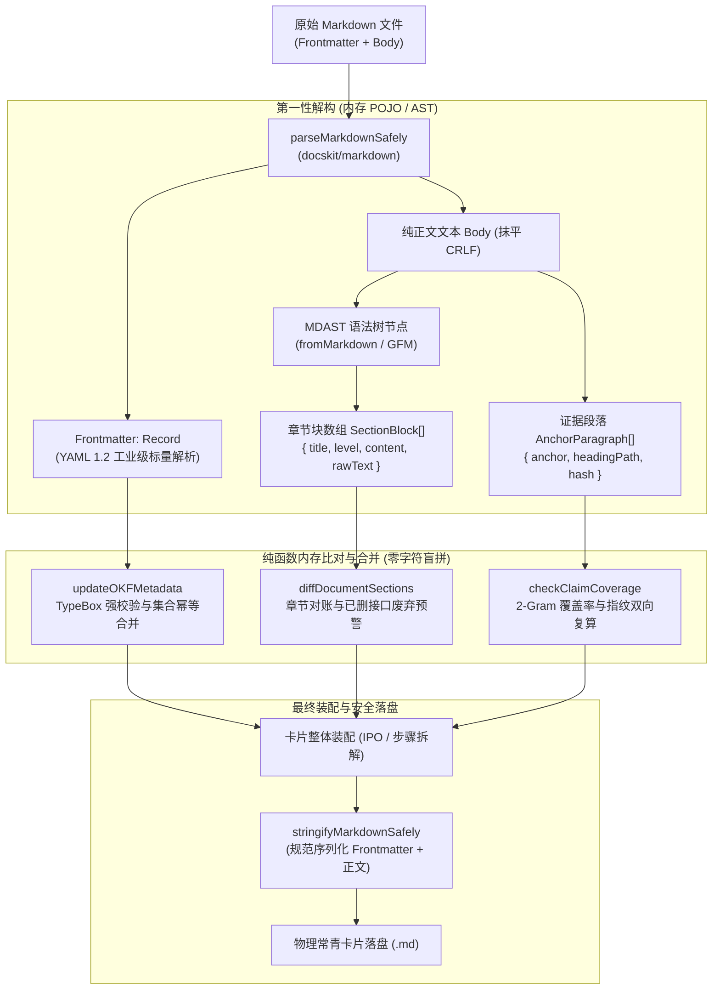
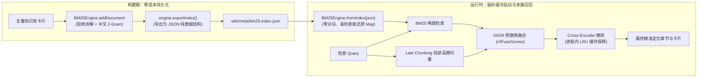

# DocsKit

### 面向编译型个人知识库与团队知识中枢的通用计算引擎
**Compile-over-Retrieval Engine for Agentic Knowledge Bases & Wikis**

[](https://www.npmjs.com/package/docskit)
[](./LICENSE)
[](./package.json)
[](https://nodejs.org/)
[](./tests/)

[核心定位](#-核心定位与解决的核心痛点) • [快速开始](#-快速开始) • [双轨编译架构](#-双轨编译与数据流转模型) • [检索供给链](#-检索供给链与倒排持久化) • [能力矩阵](#-能力一览-14-个原子子路径) • [搭建指南](#-搭建两种经典知识库模式)

---

## 💡 核心定位与解决的核心痛点

在构建面向 LLM Agent 的知识库或数字花园时，知识管理通常面临两类关键工程挑战：
1. **上下文碎片化**：若未经语法与结构提纯，长篇文档被简单切分后容易导致逻辑撕裂，检索出的片段缺乏完整的机制阐述；
2. **文档脆弱性与代码分叉**：不同知识项目往往自行手写正则去增删替换 Markdown。简单的行正则容易误把代码块内的注释判定为标题，元数据格式微调容易引发正文重复写入，而历史废弃的接口在文档更新后缺乏显式警示。

**DocsKit 将复杂的文档处理下沉为标准化的编译流水线：**
- **入库编译，结构化提纯**：素材进入知识库前，基于 AST 语法树完成章节级差量对账与提纯，保留已有知识主干，变更与废弃接口自动打上警示标记；
- **纯函数无状态计算**：底层均为无副作用的纯计算函数与门禁，业务层仅需关注数据源与目标路径，计算逻辑高度解耦；
- **纯本地轻量运行**：底层基于人类可读的 Markdown 文件与本地轻量特征文件，不依赖重型外部数据库集群，离线亦可秒级运行；
- **全机模型缓存共享**：向量特征计算统一采用轻量级模型，同机多项目共享本地缓存，避免重复开销。

---

## ⚡ 快速开始

### 安装与环境要求

- **Node.js** >= 20（推荐 Node 22+ 享受原生 V8 编译缓存）
- **包管理器**：推荐使用 `pnpm`

```bash
# 从源码构建
pnpm install
pnpm build
```

> [!NOTE]
> `docskit/sense` 的 Late Chunking 基于本地 ONNX 推理，首次运行会将轻量模型（`Xenova/bge-small-zh-v1.5`）自动缓存至 `~/.cache/onnx-models`。

### 极简调用示例

```ts
import { buildSnapshotPath } from "docskit/snapshot";
import { isProtectedPath } from "docskit/lint";
import { checkContentIdempotency } from "docskit/hash";
import { runPipeline } from "docskit/pipeline";

const raw = `## 背景
首屏渲染慢。

## 方案
引入流式服务端渲染。
`;

// 1. 原始素材路由至只读底座，确保信源不可变
const snapshot = buildSnapshotPath({ category: "articles", title: "流式渲染", revision: 1 });
console.log(snapshot);                 // _raw/articles/流式渲染-rev1.md
console.log(isProtectedPath(snapshot)); // true (自动识别受保护底座)

// 2. 纯正文指纹校验：内容未变即秒级 0-Token 短路，省掉模型调用开销
const knownHashes = new Set<string>();
const gate = checkContentIdempotency(raw, knownHashes);

if (!gate.shouldSkip) {
  // 3. 声明式编译流水线：抽取 IPO 核心机制并封装 YAML Frontmatter
  const result = await runPipeline(raw, {
    title: "流式渲染",
    compileMode: "distill",
    modeling: "ipo",
  });

  console.log(result.action);       // DISTILLED
  console.log(result.fullMarkdown); // 带标准 YAML 标量头与结构的常青卡片
}
```

---

## 🏗️ 双轨编译与数据流转模型

DocsKit 绝不是简单的文本字符串正则查找替换，而是**入库即结构化、内存全对象化计算、出库统一安全序列化**的双轨编译管道：



---

## 🔍 检索供给链与倒排持久化

针对 AI Agent 与 RAG 的高频交互，DocsKit 提供 **BM25 词项检索 + 章节级 Late Chunking 高精度局部向量 + Cross-Encoder 重排** 的混合检索管道，并原生支持**零依赖持久化**：



### 倒排索引持久化代码手势

```ts
import { BM25Engine } from "docskit/sense";

// 1. 构建期：建完索引直接落盘（0 新依赖，纯原生 JSON）
const engine = new BM25Engine();
cards.forEach(card => engine.addDocument(card.id, card.body));
await fs.writeFile("wiki/meta/bm25.json", JSON.stringify(engine.exportIndex()));

// 2. 运行时：直接反序列化，秒级还原！无需重新遍历上百张卡片与分词
const serialized = JSON.parse(await fs.readFile("wiki/meta/bm25.json", "utf8"));
const fastEngine = BM25Engine.fromIndex(serialized);
const results = fastEngine.search("TypeScript 架构", 5);
```

---

## 📦 能力一览 (14 个原子子路径)

DocsKit 遵循细粒度按需导入原则，消费方直接从 `docskit/<子路径>` 引入，Tree-Shaking 极佳。每个符号具有全仓唯一的权威子路径。

| 子路径 | 核心对外函数 | 解决的核心问题（白话说明） |
| :--- | :--- | :--- |
| **`docskit/markdown`** | `parseMarkdownSafely`<br>`stringifyMarkdownSafely`<br>`renderMarkdownTable`<br>`outdent`<br>`normalizeReadableTitle`<br>`collapseWhitespace`<br>`splitLines`<br>`stripMarkdownExtension` | **全库唯一 Frontmatter 与排版底座**。<br>接管 YAML 1.2 标量引擎，杜绝路径斜杠引发的崩溃；提供声明式表格渲染与可读标题规范化。 |
| **`docskit/numeric`** | `cosineSimilarityVectors`<br>`computeTextNgramSimilarity`<br>`computeBigramDiceSimilarity`<br>`normalizeVector` | **全库唯一数值计算底座**。<br>收敛字符级 N-gram、余弦距离、L2 归一化与 2-gram Dice，杜绝同名概念多套数值结果。 |
| **`docskit/hash`** | `computeMarkdownBodyHash`<br>`calcRawContentSha256`<br>`checkContentIdempotency`<br>`computeShortHash`<br>`computeSha256Hex` | **哈希与 0-Token 幂等门禁**。<br>抹平换行符后计算纯文本与正文 SHA-256，在 LLM 调用前提供 $O(1)$ 纯内存幂等短路。 |
| **`docskit/ast`** | `normalizeMarkdownContent`<br>`parseMarkdownWithAST`<br>`distillMarkdownContent`<br>`getMarkdownFiles` | **语法树解析与章节切块**。<br>基于 MDAST 提纯文章结构，杜绝代码注释和表格被粗暴截断；基于 `fdir` 提供毫秒级文件扫描。 |
| **`docskit/patch`** | `diffDocumentSections`<br>`applySectionPatch`<br>`evaluateDedupGate`<br>`findFuzzyLexicalMatch`<br>`findMostSimilarVector` | **修改合并与级联去重**。<br>文档改动时章节比对合并，已删接口打废弃警告；内置长度比率、Fuse.js、向量余弦与字符级四级去重防线。 |
| **`docskit/snapshot`** | `buildSnapshotPath`<br>`parseSnapshotMeta`<br>`isVersionNewer`<br>`sanitizeFileName`<br>`isTombstoneHit`<br>`resolveCardPathCollision` | **快照路径与防重墓碑**。<br>声明式解构分类、标题与版本；提供跨平台文件名清洗、并存卡片路径仲裁与放弃素材墓碑阻断。 |
| **`docskit/sense`** | `BM25Engine`<br>`computeLateChunking`<br>`rrfFuseScores`<br>`executeHybridRankPipeline`<br>`createReranker` | **混合检索与持久化索引**。<br>驼峰+中文 2-Gram 稀疏检索；支持倒排表 JSON 序列化持久化；提供 Late Chunking 与 Cross-Encoder 重排。 |
| **`docskit/graph`** | `extractWikilinks`<br>`extractWikiOutboundLinks`<br>`indexBidirectionalGraph`<br>`normalizeWikilinkTarget`<br>`stripAnchor`<br>`stripAlias`<br>`countContentWords` | **引用图谱与中英字数统计**。<br>剥离代码围栏精准提取 `[[双链]]`；自动编织卡片间的双向 1-Hop 拓扑图，提供 CJK+Latin 统一字数统计。 |
| **`docskit/lint`** | `lintVaultTopology`<br>`auditDirectoryVault`<br>`isProtectedPath`<br>`evaluateToolCallPathGuard`<br>`auditVaultLifecycle`<br>`findHighSimilarityCardPairs`<br>`auditSupersedeChain`<br>`checkTitleStemConsistency` | **文档巡检与物理底座守护**。<br>全库死链、孤岛与 OKF Schema 巡检；提供 Agent 工具调用只读目录拦截；提供陈旧卡片与重复卡片排查。 |
| **`docskit/evidence`** | `splitAnchorableParagraphs`<br>`buildSourceRefs`<br>`verifySourceRef`<br>`checkClaimCoverage`<br>`mechanicalClaim` | **证据链与声明句覆盖校验**。<br>段落级锚点确定性切分与短哈希指纹复算；结论句 2-Gram 覆盖校验，不达标退回机械首句。 |
| **`docskit/presets`** | `ZH_CN_DISTILL_OPTIONS`<br>`ZH_CN_NORMALIZE_TEXTS`<br>`ZH_CN_JIT_RENDERER`<br>`ZH_CN_SECTION_TEXTS`<br>`ZH_CN_LABELS` | **可选中文业务预设**。<br>提供 IPO 建模模板、附件清单、JIT 提示词与废弃声明，保持引擎层 100% 零业务中文纯度。 |
| **`docskit/jit`** | `formatAgentJITPrompt` | **JIT 上下文渐进装配**。<br>提供符合 Karpathy LLM-Wiki 规范的三级装配上下文（指针+摘要 / 深度正文），严格控制 Token 预算。 |
| **`docskit/okf`** | `createOKFMetadata`<br>`validateOKFMetadata`<br>`updateOKFMetadata`<br>`buildOKFConceptCard`<br>`OKFFrontmatterSchema` | **OKF 元数据契约**。<br>基于 TypeBox 声明卡片 Frontmatter 的字段、枚举与强校验规则，支持增量补丁合并与集合去重。 |
| **`docskit/pipeline`** | `runPipeline` | **四阶段编译流水线**。<br>将清洗、门禁、提纯对账、元数据封装等各阶段串联为开箱即用的声明式编译引擎。 |

---

## 📚 搭建两种经典知识库模式

DocsKit 用同一套通用函数同时支撑两种不同组织哲学的知识系统：

```
                    ┌─── 个人原子知识库 (提纯型) ───> 提炼机制主干、防同义碎片化、高信噪比常青卡片
DocsKit 通用计算引擎 ┤
                    └─── 团队方案知识库 (对账型) ───> 版本增量对账、废弃接口警示、责任链与演化链
```

- **个人原子知识库（提纯型）**：素材多为外部深度长文与思考碎片。主链路走 `distill`（IPO 机制建模抽取），配合级联去重门禁避免将同一概念存为多张碎片卡片。
- **团队方案知识库（对账型）**：方案按修订版本反复同步。主链路走 `patch`（章节差量合并），保留已有卡片正文，若检测到接口删除自动在卡片注入废弃警告，且人工审定卡片（`lock: human`）具备强写入保护。

> 📖 **可运行的端到端搭建配方**：完整代码示例、差异对照表与交付前自检清单详见 [`docs/BUILDING-VAULTS.md`](docs/BUILDING-VAULTS.md)。

---

## 🛡️ 架构约束与编码审美

本库自身即全机「编译型知识库通用引擎」的架构标杆：
1. **引擎零业务偏见**：通用函数不写死任何特定目录或项目私有字段，需要过滤时一律由业务层传参；
2. **引擎方法体零业务中文**：`contracts/`、`foundation/`、`layers/` 内部方法体零中文，文案与模板一律收敛至 `presets/`；
3. **策略数值单一真理源**：阈值、权重、上限集中在 [`src/contracts/policy.ts`](src/contracts/policy.ts) 冻结表，禁止在业务方法体手写魔法数字；
4. **库优先于手搓**：路径一律 `pathe`，模式匹配一律 `picomatch`，集合变换一律 `radash`，Schema 一律 `typebox`，杜绝过程式 `for` 游标、天书捕获正则与非空断言；
5. **Node 原生编译加速**：统一门面集成 Node 22+ `module.enableCompileCache()`，零依赖享受 V8 编译磁盘缓存。

---

## 🧪 本地开发与质量验证

```bash
pnpm typecheck   # TypeScript 严格类型检查 (0 error 门禁)
pnpm test        # node:test 原生测试套件 (72/72 全绿)
pnpm build       # tsup 构建 ESM 模块与高纯度 .d.ts 声明
```

DocsKit 遵循规约驱动开发（OpenSpec），所有重大架构调整、数值变动与新特性均在 `openspec/changes/` 下立项、设计并完成验收。

---

## 📄 扩展与进阶文档

- [分层能力路线图与四阶段编排 (`docs/CAPABILITIES.md`)](docs/CAPABILITIES.md)
- [编译型知识库搭建指南与配方 (`docs/BUILDING-VAULTS.md`)](docs/BUILDING-VAULTS.md)
- [OKF v0.2 卡片元数据规范与下游扩展 (`docs/OKF-v0.2-SPECIFICATION.md`)](docs/OKF-v0.2-SPECIFICATION.md)
- [DocsKit 跨 Agent 唯一开发宪法 (`AGENTS.md`)](AGENTS.md)

---

## 📜 开源协议

本项目采用 [MIT 许可证](./LICENSE) 开源。
