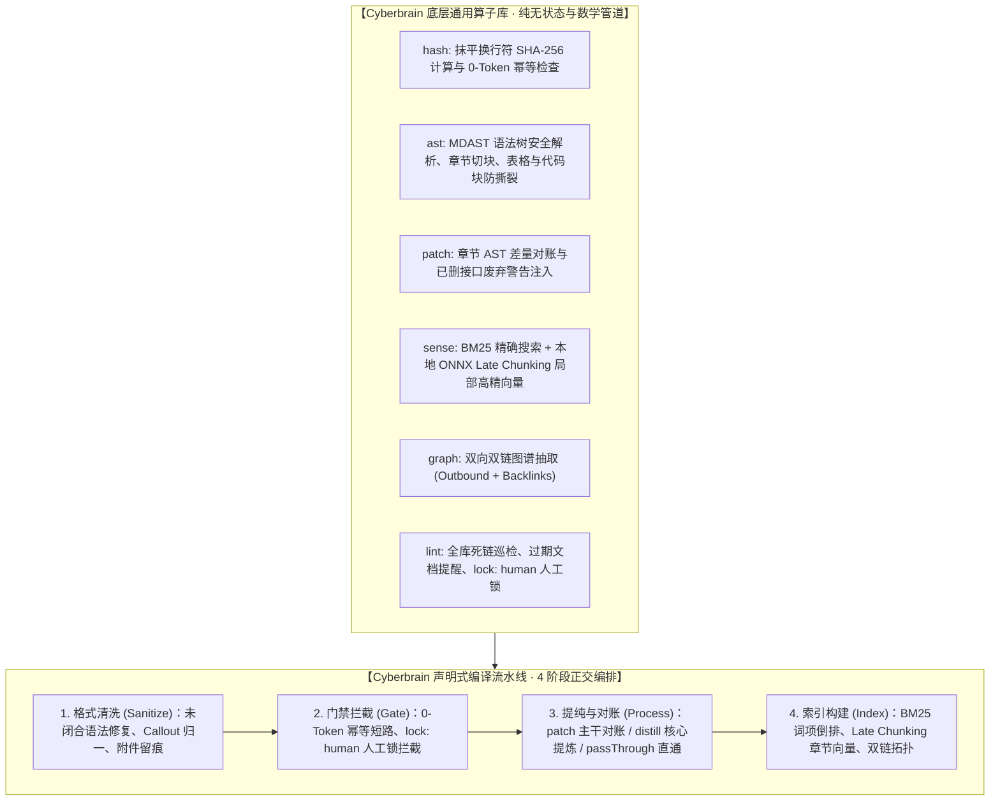

# Cyberbrain (電脳) 知识库通用计算引擎分层能力路线图

> 🧠 **Cyberbrain**：编译型知识库核心通用计算与处理引擎（Compile-over-Retrieval Engine）。  
> **核心原则**：底层只做纯算子（零业务偏见与私有项目绑定），上层提供极简、正交且声明式可配置的编译流水线（Pipeline），消灭跨知识库重复开发。

---

## 一、 系统架构总览：纯算子底座 + 声明式组合流水线

---

## 二、 拒绝过度分类，回归编译的四个正交阶段

知识库流水线剥离具体业务特化后，本质上只有 4 个正交阶段，调用者通过 `PipelineOptions` 自由开启或传参：

| 阶段（Stage） | 职责与白话解释 | 核心算子 | 常用配置选项 |
| :--- | :--- | :--- | :--- |
| **1. 清洗与文本算子 (Sanitize)** | 抹平换行、统一 Callout 为 GitHub 块引用、识别外部二进制附件并在文末留痕；提供 `outdent` 模板去缩进、`renderMarkdownTable` 表格渲染、标量安全 Frontmatter 与 `appendUnderHeading` 章节追加。 | `core/ast` | `features.extractAttachments` |
| **2. 门禁 (Gate)** | 处理前快速拦截：正文指纹未变立即 0-Token 退出，遇到人工锁 `lock: human` 绝不擅自覆盖。 | `core/hash` `core/lint` | `gates.idempotency` `gates.humanLock` |
| **3. 提纯与对账 (Process)** | **主干对账（patch）**：新老章节 AST 对比，修改就地更新，已删章节打废弃警告； **核心提炼（distill）**：抽取 IPO 结构与精选代码； **直通（passThrough）**：保留清洗后原文。 | `core/patch` `core/ast` | `compileMode: "patch" \| "distill" \| "passThrough"` `deprecationNotice: boolean` |
| **4. 索引与感知 (Index)** | 词项精确检索与章节级高精度向量索引。 | `core/sense` `core/graph` | `BM25Engine` `computeLateChunking` `buildBacklinksGraph` |

---

## 三、 跨项目使用铁律

1. **绝对禁止在内核硬编码任何具体项目名**：
   - 严禁在 Cyberbrain 代码与通用流水线中写死特定工程名称；通用引擎对外只暴露通用范式与配置钩子。
2. **底层纯算子与上层流水线彻底分离**：
   - 底层 `src/core/` 必须是 100% 纯函数、无状态、无副作用，随时可单独 import 使用；
   - 上层 `src/pipeline/` 负责按配置组合调度，参数扁平直给，杜绝类型体操。
3. **改动先在提案留档**：
   - 通用引擎要做重大改动或加新算法，统一在 `Cyberbrain/openspec/changes/` 下立项驱动。
