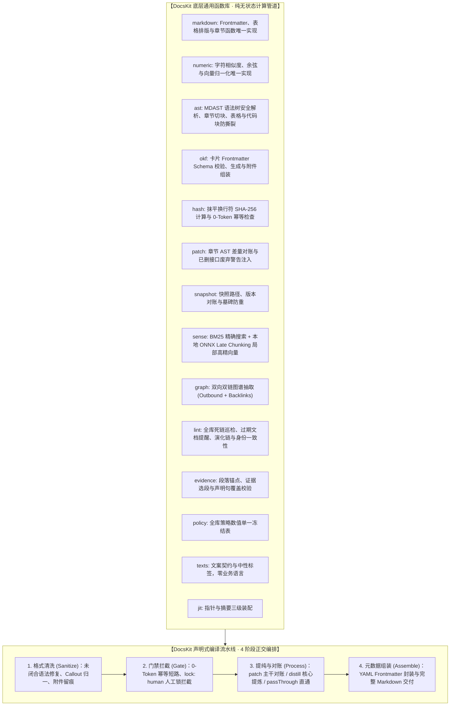

# DocsKit 分层能力路线图

> **DocsKit**：编译型知识库通用计算与处理引擎（Compile-over-Retrieval Engine）。
> **核心原则**：底层只做纯函数（零业务偏见与私有项目绑定），上层提供极简、正交且声明式可配置的编译流水线（Pipeline），消灭跨知识库重复开发。

## 系统架构总览

图里 Core 子图的能力模块与 `package.json exports` 一一对账，流水线和可选业务预设各自单独占一层。物理目录按 `foundation`、`ingest`、`compile`、`retrieval`、`governance` 分组，导出子路径仍按能力命名，二者由 `tsup.config.ts` 映射。索引构建与证据链都不在 `runPipeline` 内，BM25 倒排、Late Chunking 章节向量、双链图谱与段落锚点由业务层按自己的时机单独调用，配方见 `docs/BUILDING-VAULTS.md`。中文模板、提示词与诊断句子全部收在 `docskit/presets`，引擎方法体零业务语言。各子路径的关键函数清单见 `README.md` 的能力一览表。

### 目录分层与能力导出

能力原子化是函数级原则，目录分层是组织级原则。函数仍按能力导出，十三个 `docskit/*` 子路径一个不改，物理目录按搭库时的消费时机分组。

| 物理目录 | 能力模块 | 在哪一层用 |
| :--- | :--- | :--- |
| `src/contracts/` | `markdown.ts`、`policy.ts`、`texts.ts` | 格式、策略与文案约定，直接放 src 下 |
| `src/foundation/` | `numeric.ts`、`hash.ts`、`wikilink.ts`、`guard.ts` | 横切所有层的纯计算与门禁工具，全部单文件 |
| `src/layers/ingest/` | `ast`、`snapshot` | 第一层，素材清洗与只读底座 |
| `src/layers/compile/` | `patch`、`okf`、`evidence`、`pipeline` | 提纯对账、证据锚点、元数据组装 |
| `src/layers/retrieval/` | `sense`、`graph`、`jit` | RAG 检索、双链图、上下文装配 |
| `src/layers/governance/` | `lint` | 全库巡检与治理 |
| `src/presets/` | 中文预设 | 可选业务适配层 |

`tsup.config.ts` 的 entry 把每个子路径指到新位置，消费方导入时不需要知道层。`foundation/wikilink.ts` 把双链字符串归一从检索层下沉，`governance/lint/topology.ts` 直接消费它，治理层不再为几个字符串函数反向依赖检索层。

## 四个正交阶段

知识库流水线剥离具体业务特化后，只有 4 个正交阶段，调用者通过 `PipelineOptions` 自由开启或传参：

| 阶段（Stage） | 职责与白话解释 | 核心函数 | 常用配置与函数 |
| :--- | :--- | :--- | :--- |
| **1. 清洗与文本函数 (Sanitize)** | 抹平换行、统一 Callout 为 GitHub 块引用、识别外部二进制附件并在文末留痕。`markdown` 提供 `parseMarkdownSafely`、`stringifyMarkdownSafely`、`renderMarkdownTable`、`outdent` 与 `dropSection`、`extractSection`、`appendUnderHeading`、`extractDocumentTitle`、`sanitizeLatexToUnicode` 等章节和排版函数，`ast` 负责语法树解析与文件扫描。 | `contracts/markdown.ts` `layers/ingest/ast` | `features.extractAttachments` `features.transformLink` |
| **2. 门禁 (Gate)** | 处理前快速拦截：正文指纹未变立即 0-Token 退出，遇到人工锁 `lock: human` 绝不擅自覆盖；提供 `isProtectedPath` 通用 Agent 只读拦截，以及全库过期卡片与高相似度卡片对分析（`analyzeCardLifecycle`）。 | `foundation/hash.ts` `layers/governance/lint` | `gates.idempotency` `gates.humanLock` `evaluateToolCallPathGuard`（独立函数） |
| **3. 提纯与对账 (Process)** | **主干对账（patch）**：新老章节 AST 对比，修改就地更新，已删章节打废弃警告； **级联去重（dedup）**：Fuse.js 长度比率词形门禁 + 向量池余弦语义，彻底阻断概念同义碎片化； **核心提炼（distill）**：抽取 IPO 结构与精选代码； **直通（passThrough）**：保留清洗后原文。 | `layers/compile/patch` `layers/ingest/ast` | `compileMode: "patch" \| "distill" \| "passThrough"` `features.deprecationNotice` `DedupGateOptions.threshold` |
| **4. 元数据组装 (Assemble)** | 合并旧卡片、新素材与废弃声明，经 `metadata.transform` 后置处理，由 `stringifyMarkdownSafely` 封装 Frontmatter，交付纯正文与完整 Markdown。强契约校验要业务层另调 `validateOKFMetadata`；检索与图谱（`BM25Engine`、`computeLateChunking`、`indexBidirectionalGraph`）也在流水线之外按需构建。 | `contracts/markdown.ts` `layers/compile/okf`（可选） | `metadata.defaultValues` `metadata.transform` `validateOKFMetadata` |

## 跨项目使用铁律

1. **绝对禁止在内核硬编码任何具体项目名**：
   - 严禁在 DocsKit 代码与通用流水线中写死特定工程名称；通用引擎对外只暴露通用范式与配置钩子。
   - 段落锚点、声明句覆盖、演化链判定与身份一致性巡检也一律消费 `docskit` 的纯函数，业务层不在本地另写一份。
2. **底层纯函数与上层流水线彻底分离**：
   - `src/foundation/` 与 `src/layers/` 必须是 100% 纯函数、无状态、无副作用，随时可单独 import 使用；
   - 上层 `src/pipeline/` 负责按配置组合调度，参数扁平直给，杜绝类型体操。
3. **改动先在提案留档**：
   - 通用引擎要做重大改动或加新算法，统一在 `DocsKit/openspec/changes/` 下立项驱动。
4. **引擎零业务语言与策略收敛**：
   - 模板、提示词与诊断句子一律经 `texts` 注入，默认值走 `contracts/texts.ts` 的中性标签，业务中文只待在 `src/presets/`；
   - 阈值、权重、上限与精度只在 `contracts/policy.ts` 声明，options 在解构处显式覆盖；
   - 重复两处以上的小工具（哈希摘要、空白归一、行切分、扩展名与锚点剥离）收敛到公共底座，业务文件不得重写。
5. **消费方按子路径导入**：
   - 业务代码一律从 `docskit/<子路径>` 引入，根 barrel 只留给一次性脚本与工具入口；
   - 每个符号只有一个权威子路径，能力模块不得重导出别处符号；
   - 重型依赖由模块内部惰性加载，冷启动耗时口径与子路径对账规则见 `AGENTS.md`。
